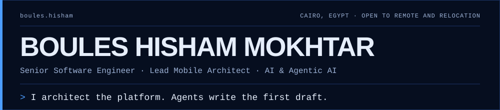

<div align="center">




<a href="https://bolespolo4.github.io/portifilio/"></a>
<a href="https://www.linkedin.com/in/boules-engineer/"></a>
<a href="mailto:bolespolo4@gmail.com"></a>
<a href="https://github.com/bolespolo4"></a>
<a href="https://github.com/bolespolo4"></a>

My portfolio is live: <strong><a href="https://bolespolo4.github.io/portifilio/">bolespolo4.github.io/portifilio</a></strong>. Five chapters on mobile platforms, ERP, e-commerce, web SaaS and agentic AI tooling.

</div>

---

## 👨‍💻 About Me

Senior Software Engineer with **6+ years** architecting and delivering platforms, not just apps: multi-platform mobile on Clean Architecture, SOLID principles and Dart 3 sealed-class type safety, plus the backends, ERP suites and AI tooling around them.

- 📱 **Mobile platforms**: lead architect of **PAAS** at Qara Digital Solutions, a single-codebase platform powering **20+ live production apps** across the Saudi market, with a self-built multi-flavor CI/CD pipeline, a multi-theme control dashboard and fully self-hosted release infrastructure.
- 🏢 **ERP suites**: as Head of Mobile at CorporateStack I led 10+ engineers and delivered CS HRMS, CS CRM and CS Assets, with 5+ major launches.
- 🛒 **E-commerce**: a React and TypeScript SaaS platform handling **10,000+ monthly transactions**, with native payment gateways, wallet and points, and WordPress and Salla integrations.
- 🌐 **Web SaaS**: Django, Vue and React platforms serving **80+ enterprise clients** at Ergasti Digital, plus NestJS, PostgreSQL, Redis and WebSocket backends.
- 🤖 **AI & agentic tooling**: LLM and MCP toolkits, custom agent modes and self-hosted models wired into my IDE. I build my own AI-assisted tooling rather than just consuming off-the-shelf copilots.

I also own the platform's security and DevSecOps posture: Firebase App Check, RASP hardening (certificate pinning, root/jailbreak detection) and incident response when things go wrong.

```dart
class BoulesHisham {
  final String role     = "Senior Software Engineer / Lead Mobile Architect / Agentic AI";
  final String location = "Cairo, Egypt 🇪🇬 (Open to Remote / Relocation)";
  final String current  = "Lead Mobile Architect @ Qara Digital Solutions (KSA)";

  final List<String> expertise = [
    "Clean Architecture & SOLID Principles",
    "Dart 3 Sealed Classes & Type Safety",
    "BLoC / Cubit State Management",
    "Multi-Flavor CI/CD & Self-Hosted Runners",
    "Mobile App Security (App Check, RASP, mTLS)",
    "Firebase Full-Stack Integration",
    "Agentic AI (MCP, custom agent modes, self-hosted LLMs)",
    "Backend & APIs (NestJS, Node.js, .NET, Django, Laravel)",
    "ERP & Web SaaS (HRMS / CRM / Assets, React, Vue)",
  ];

  final String philosophy = "Build it right — not just make it work.";
}
```

---

## 🛠️ Tech Stack

<h4 align="center">📱 Mobile</h4>

<p align="center">

</p>

<p align="center">
&nbsp;
&nbsp;
&nbsp;
&nbsp;

</p>

<h4 align="center">🌐 Backend &amp; Web</h4>

<p align="center">

</p>

<p align="center">
&nbsp;
&nbsp;
&nbsp;
&nbsp;

</p>

<h4 align="center">🗄️ Data &amp; Firebase</h4>

<p align="center">

</p>

<p align="center">
&nbsp;
&nbsp;
&nbsp;
&nbsp;

</p>

<h4 align="center">⚙️ DevOps &amp; CI/CD</h4>

<p align="center">

</p>

<p align="center">
&nbsp;
&nbsp;
&nbsp;

</p>

<h4 align="center">🔐 Security</h4>

<p align="center">
&nbsp;
&nbsp;
&nbsp;
&nbsp;

</p>

<h4 align="center">🤖 AI &amp; Agentic</h4>

<p align="center">
&nbsp;
&nbsp;
&nbsp;
&nbsp;
&nbsp;

</p>

---

## 🚀 Key Projects

### 🏆 PAAS — Multi-Tenant Mobile Platform
> Flutter · Dart 3 · Firebase · ObjectBox · GitHub Actions

Single shared codebase powering **20+ live production apps** (Android + iOS) across the Saudi market.

- 🏗️ Feature-cluster modular Clean Architecture (`/clusters/`, `/users/`, `/core/`, `/di/`)
- ⚡ Remote Asset System (ObjectBox + Firebase RTDB) — **zero app releases required** for brand/theme updates
- 🔒 Dart 3 sealed-class ImageLoader — compile-time-safe image rendering
- 🔄 Self-hosted CI/CD: GitHub Actions runners on dedicated hardware + VPS, packaging every branded flavor from one codebase
- ✅ Automated CI-integrated QA pipeline (`flutter_test`, `bloc_test`, `mockito`) generating test-status reports on every PR

### 🔒 Mobile App Security Hardening — PAAS
> Firebase App Check · Play Integrity · RASP · mTLS

Rolled out Firebase App Check across PAAS's multi-flavor builds — Play Integrity for production, a fixed-UUID debug provider for QC/staging — layered on top of an existing RASP posture (certificate pinning, root/jailbreak detection).

- 🚨 Responded to a real security incident (a leaked private Dart package) by implementing mTLS client-certificate authentication and SSH key-based access controls for the self-hosted CI/CD pipeline
- 🧹 Followed through with full post-incident hygiene across affected infrastructure

### ⚙️ Self-Hosted CI/CD Infrastructure — PAAS
> Ubuntu · GitHub Actions Runners · Bare-Metal Hardware

Built and operate PAAS's self-hosted CI/CD on dedicated hardware (HP EliteDesk running Ubuntu) rather than relying on hosted runner minutes.

- 🔧 Debugged runner registration failures and OOM crashes under load
- 📦 Pre-installed and pinned the Flutter SDK (3.29.0) and Android SDK without a full Android Studio install
- 🔁 Rewrote the project's quality-gate as a reusable GitHub Actions workflow shared across the monorepo

### 🤖 AI-Assisted Dev Environment — RooCode + Self-Hosted LLMs
> RooCode · Ollama · OpenRouter · Continue CLI

Built a custom AI-assisted development setup for the PAAS monorepo rather than using default copilot tooling out of the box.

- 🧩 Custom RooCode modes tuned separately for frontend, Flutter/mobile, and DevSecOps workflows
- 🖥️ Self-hosted Ollama on a VPS running `qwen2.5-coder` and `qwen3-coder`, wired into Android Studio and VS Code via the Continue CLI

<details>
<summary><strong>🧰 More projects & tooling</strong> — macOS menu bar app, internal packages, CLIs and code generators</summary>
<br />

### 🎙️ JARVIS-Inspired Menu Bar App
> Swift · SwiftUI · macOS · AppKit

A native macOS menu bar utility that polls Jira and triggers GitHub Actions APK builds directly from the desktop — built to cut the friction of jumping between Jira, GitHub, and a terminal just to kick off a build.

- 🛠️ Worked through AppKit integration quirks and Keychain entitlement issues to get secure credential storage working natively

### 📦 Internal Package Monorepo — qara_widgets / qara_core / qara_auth / scanner
> Flutter · Dart · Package Architecture

4 internal Flutter packages enabling code reuse across the app suite, with strict versioned API boundaries between modules.

### 🛠️ Chameleon CLI — Multi-Environment Developer Tooling
> Node.js · TypeScript · Python · Shell

Production CLI for multi-environment config orchestration with graceful API fallback. Released as **v2.0.0**.

### ⚙️ Model Generator & 🎨 Resources Generator — Flutter/Dart Utilities
> Flutter · Dart · build_runner

Two open-source Flutter dev tools: build-time model code generation, and compile-time-safe access to UI resources (colors, fonts, assets).

</details>

---

## 💼 Experience

| Role | Company | Period |
| :--- | :--- | :--- |
| **Senior Software Engineer — Lead Mobile Architect** | Qara Digital Solutions · Remote (KSA) | Sep 2023 – Present |
| **Head of Mobile Development** | CorporateStack Solutions · Cairo, Egypt | Mar 2022 – Sep 2023 |
| **Full-Stack Developer** | Ergasti Digital · Cairo, Egypt | Oct 2019 – Mar 2022 |

---

## 📜 Certifications

- 🎓 **CS50: Introduction to Computer Science** — Harvard University
- 🎓 **CS50: Introduction to Programming with Python** — Harvard University
- 🏅 **Flutter Apprentice** — Google
- 🎓 **The Complete Flutter & Dart Bootcamp** — Udemy

---

## 🌱 Currently Exploring

- 🎨 Deepening front-end engineering skills — working a vanilla JS → React roadmap alongside mobile work
- 🔍 CI security scanning tooling (CodeQL, Snyk, Semgrep) and visual regression / PR preview deployment workflows
- 🌿 Git workflow refinement — rebase-first strategies, cherry-pick promotion across environments

---

## 📊 GitHub Stats

<div align="center">


</div>

---

## 🌍 Languages &nbsp;·&nbsp; 🤝 Open To

| 🌍 Languages | 🤝 Open to |
| :--- | :--- |
| 🇪🇬 **Arabic** — Native | 💼 Senior Software Engineer / Mobile Architect roles |
| 🇬🇧 **English** — Professional Proficiency | 🌍 Remote positions worldwide · ✈️ Relocation |
| 🇪🇸 **Spanish** — Beginner | 🧩 Freelance/contract Flutter work (active on Mostaql) · 🤝 OSS collaboration on Flutter packages |

---

<div align="center">

[](https://bolespolo4.github.io/portifilio/) [](https://www.linkedin.com/in/boules-engineer/) [](mailto:bolespolo4@gmail.com)

</div>
